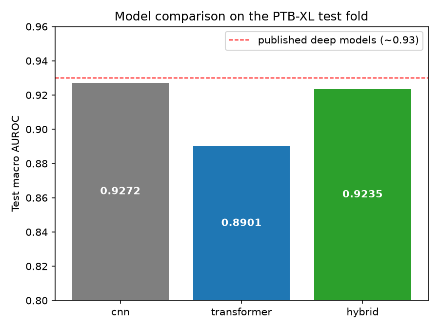

# ECG Disease Prediction: Patch Transformer + LLM Report

Trial project (Natdanai, MUICT). Predicts 5 diagnostic superclasses from 12-lead ECGs (PTB-XL), compares a 1D-CNN, a patch Transformer and a hybrid CNN + Transformer, explains predictions with attention maps, and writes a short plain-language report.

## Results (official PTB-XL test fold)

| Model | Parameters | Train time | Macro AUROC | NORM | MI | STTC | CD | HYP | Macro F1 |
|---|---|---|---|---|---|---|---|---|---|
| 1D-CNN (baseline) | 190,757 | 30 s | **0.9272** | 0.946 | 0.923 | 0.939 | 0.922 | 0.906 | 0.748 |
| Patch Transformer | 610,565 | 50 s | **0.8901** | 0.918 | 0.857 | 0.915 | 0.880 | 0.881 | 0.687 |
| Hybrid CNN + Transformer | 622,117 | 99 s | **0.9235** | 0.945 | 0.919 | 0.931 | 0.920 | 0.902 | 0.735 |

One run per model (seed 42) on an RTX 4050 laptop GPU. Published deep models reach about 0.93.



**Bonus: anomaly detection.** A convolutional autoencoder (32,980 parameters) trained on normal ECGs only, with the reconstruction error as anomaly score, separates normal from abnormal test ECGs with AUROC **0.755**. For reference: signal energy alone gives 0.612, and the supervised CNN gives 0.939 on the same question.


## Setup

Python 3.10+ is required.

```bash
python -m venv .venv
# Windows:  .venv\Scripts\activate        macOS/Linux:  source .venv/bin/activate

# PyTorch: pick the command for your system from https://pytorch.org/get-started/locally/
# Example for an NVIDIA GPU (CUDA 12.6):
pip install torch --index-url https://download.pytorch.org/whl/cu126

pip install numpy pandas scipy scikit-learn wfdb matplotlib tqdm pyyaml jupyter
pip install transformers gradio      # report with the free local Qwen model + test website
pip install anthropic                # only if you want Claude to write the reports instead
```

The device is chosen automatically: CUDA → MPS (Apple) → CPU. On Google Colab, PyTorch is already installed; run only the last `pip install` line.

## Data

PTB-XL v1.0.3 (open access): https://physionet.org/content/ptb-xl/1.0.3/

```bash
wget -r -N -c -np -nH --cut-dirs=3 -P data/ptb-xl https://physionet.org/files/ptb-xl/1.0.3/
```

Or download the zip from the PhysioNet page and unzip it so that these exist:

```
data/ptb-xl/ptbxl_database.csv
data/ptb-xl/scp_statements.csv
data/ptb-xl/records100/
```

Only the 100 Hz records (`records100`) are needed. `data/` is not committed to git.

## How to run each step

Run everything from the project root.

| Step | Command | Main outputs |
|---|---|---|
| 1. Load data, build labels, cache | `python -m src.data` | `data/cache/*.npy`, `figures/class_distribution.png`, `figures/example_ecgs.png`, `results/class_counts.csv` |
| 2. Filter + normalization stats | `python -m src.preprocess` | `data/cache/X_filtered.npy`, `data/cache/norm_stats.npz`, `figures/preprocessing_before_after.png` |
| 2b. Check a batch | `python -m src.dataset` | prints batch shapes |
| 3. Train CNN baseline | `python -m src.train --config configs/cnn.yaml` | `results/cnn/`, `figures/training_curves_cnn.png` |
| 4. Train patch Transformer | `python -m src.train --config configs/transformer.yaml` | `results/transformer/` |
| 5. Train hybrid | `python -m src.train --config configs/hybrid.yaml` | `results/hybrid/` |
| 6. Attention maps, ROC, comparison | `python -m src.explain --run transformer --roc-run cnn --compare cnn transformer hybrid` | `figures/attention_*.png`, `figures/roc_curves.png`, `figures/model_comparison.png` |
| 6b. Attention maps for the hybrid | `python -m src.explain --run hybrid --prefix attention_hybrid` | `figures/attention_hybrid_*.png` |
| 7. Reports | `python -m src.llm_report --config configs/llm.yaml` | `results/llm_reports.md` |
| 7b. How often does the LLM text pass the checks? | `python -m src.llm_report --check-val 100` | `results/llm_check.json` |
| 7c. Test website | `python -m src.app` | opens http://127.0.0.1:7860 |
| 8. Final table | `python -m src.evaluate --final-table cnn transformer hybrid` | `results/final_table.md` |
| 8b. Confusion matrices (TP/FP/FN/TN per class) | `python -m src.confusion` | `results/confusion_matrix.md`, `results/confusion_matrix.csv`, `figures/confusion_matrices.png` |
| 9. Bonus: autoencoder anomaly detection | `python -m src.anomaly --config configs/autoencoder.yaml` | `results/autoencoder/`, `figures/anomaly_score_histogram.png`, `figures/anomaly_reconstruction_examples.png` |
| 10. Presentation | open `notebooks/presentation.ipynb` | loads saved results, no training |

Notes:
- Each training run writes `results/<run>/`: `config.yaml`, `history.csv`, `best.pt` (not committed), `metrics.json`, and adds a row to `results/summary.csv`.
- Step 9 uses the CNN's saved test predictions for its reference number, so run it after step 3.
- Add `--no-test` to a training command for experiments. It reports validation numbers only, so the test fold (fold 10) is never used to choose between variants. The experiment configs `configs/cnn_posweight.yaml` and `configs/transformer_patch25.yaml` were run this way.
- All seeds are fixed to 42.

### LLM report

`configs/llm.yaml` chooses who writes the report (`provider`):

- `qwen` (default): **Qwen2.5-1.5B-Instruct**, a free open model that runs on your own computer. No account and no API key. The first run downloads it once from Hugging Face (about 3 GB); it needs about 3 GB of GPU memory and takes about 3 s per report (it also runs on CPU, more slowly).
- `anthropic`: Claude through the API. Set the environment variable `ANTHROPIC_API_KEY` (never put the key in the code). This path has not been run yet.
- anything else: a fixed template, no LLM.

Every LLM text is checked by code (disclaimer, 3–5 sentences, only numbers from the inputs, predicted classes and a time window named, correct confidence words, no interpretation wording). If the LLM is unavailable or a check fails, the template is used, so the pipeline always runs. On 100 validation ECGs, 91 Qwen reports passed the checks. Of the 5 example reports in this repository, 4 are written by Qwen and 1 by the template.

### Test website

```bash
python -m src.app
```

A local Gradio page (http://127.0.0.1:7860, nothing is uploaded). Pick one of the 2,158 test ECGs or press "Random ECG" to see the probabilities with thresholds and true labels, the attention figure, the report, and the exact inputs the report generator received. Steps 1, 2 and 5 must have been run first, because the page loads the cached data and the trained hybrid model.

## Project structure

```
configs/        one YAML file per training run + llm.yaml
src/
  data.py         loading, label mapping, fold split, caching, exploration figures
  preprocess.py   bandpass filter + standardization (train statistics only)
  dataset.py      PyTorch Dataset / DataLoaders
  models/         cnn.py, transformer.py (own encoder block), hybrid.py, autoencoder.py
  train.py        training loop, early stopping, checkpointing, logging
  evaluate.py     AUROC, threshold tuning on validation, F1, result tables
  confusion.py    TP / FP / FN / TN per class and model on the test fold (from saved predictions)
  explain.py      attention rollout, attention plots, ROC curves, comparison chart
  llm_report.py   plain-language report (local Qwen or Claude API, automatic checks, template fallback)
  app.py          local test website (Gradio)
  anomaly.py      bonus: autoencoder trained on normal ECGs, anomaly scores, figures
  utils.py        seeds, device, parameter count
notebooks/      presentation.ipynb
results/        metrics, tables, example reports
figures/        PNGs for slides
docs/
  explanations.md   study notes, one entry per milestone
  qa_prep.md        15 likely questions with answers
```

## Disclaimer

This is an AI research prototype, not a medical diagnosis tool.
